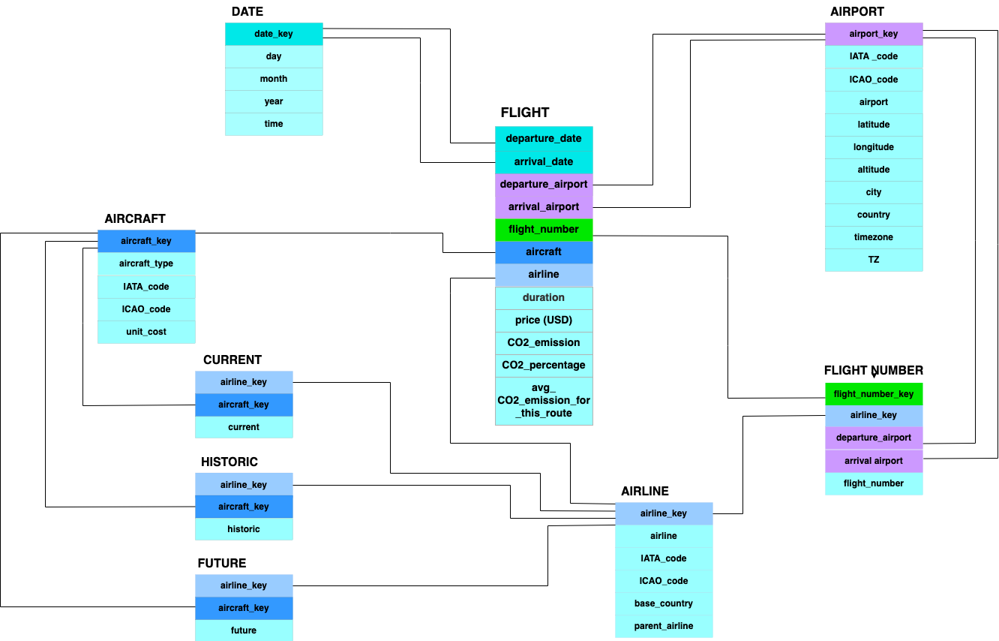

# Air Traffic and CO2 Emissions: a Data Warehouse

A data warehouse of flights, airlines, airports, aircraft and airline fleets from **April to August 2022**. It is used to study CO2 emissions, traffic, ticket prices and airline fleet investments.

The project covers the full data warehouse workflow:

1. **ETL**: Python scripts clean and integrate five Kaggle datasets (`src/`).
2. **Conceptual model**: DFM schema (`docs/DFM_schema.png`).
3. **Logical model**: snowflake schema loaded into PostgreSQL (`sql/schema.sql`).
4. **ROLAP queries**: 14 analysis queries (`sql/queries.sql`).
5. **Visual analysis**: Tableau workbooks (`tableau/`).

The full write-up is in [docs/DataWarehouseProject.pdf](docs/DataWarehouseProject.pdf).

> **Caveat:** the source flights dataset is incomplete (some flights are missing), so the results show trends rather than exact totals.

Authors: Maria Diana Calugaru, Lorenzo Mastrandrea.

## Repository layout

```
.
├── data/
│   ├── raw/                     # source datasets, unchanged (flights already filtered, see below)
│   │   ├── aircraft.csv
│   │   ├── airlines.csv
│   │   ├── airports.csv         # Latin-1 encoded
│   │   ├── fleet_data.csv       # UTF-8 with BOM, CR line endings
│   │   └── flights_nonstop.csv  # non-stop flights extracted from the full Kaggle dump
│   └── processed/               # cleaned CSVs produced by src/ and loaded into PostgreSQL
├── src/
│   ├── run_pipeline.py          # runs every cleaning step in order
│   ├── common.py                # paths and CSV helpers
│   ├── clean_aircraft.py
│   ├── clean_airlines.py
│   ├── clean_airports.py
│   ├── clean_fleet.py
│   ├── clean_flights.py
│   └── filter_nonstop_flights.py  # optional step 0, needs the full Kaggle dump
├── sql/
│   ├── schema.sql               # staging tables, CSV load, snowflake schema
│   └── queries.sql              # ROLAP analysis queries
├── tableau/                     # Tableau workbooks (they connect to the PostgreSQL DB)
└── docs/                        # report, DFM, ER and snowflake diagrams
```

## Requirements

- **Python 3.8+**. Only the standard library is used, so there is nothing to install.
- **PostgreSQL** (any recent version) with the `psql` client, to build the warehouse.
- **Tableau Desktop**, only to open the workbooks.

## Reproducing the project

All commands are run from the repository root.

### 1. Clean the data

```bash
python3 src/run_pipeline.py
```

This reads `data/raw/` and rewrites the five files in `data/processed/`. The pipeline is deterministic, so running it on the committed raw data reproduces the committed processed files byte for byte. To check:

```bash
python3 src/run_pipeline.py && git diff --stat data/processed   # no output = identical
```

Each step can also be run on its own, for example `python3 src/clean_airports.py`. The one ordering constraint is that `clean_flights.py` needs `data/processed/airlines.csv`, so `clean_airlines.py` must run first.

### 2. Build the warehouse

```bash
createdb FlightsData
psql -d FlightsData -f sql/schema.sql
```

`schema.sql` creates the staging tables, loads the CSVs with `\copy` (paths are relative, which is why it must run from the repository root), and then fills the snowflake schema. To rebuild from scratch, run `dropdb FlightsData` first.

### 3. Run the analysis queries

```bash
psql -d FlightsData -f sql/queries.sql
```

### 4. Open the Tableau workbooks

The workbooks in `tableau/` connect to the PostgreSQL database `FlightsData` on `localhost:5432` as user `postgres`. Once step 2 is done they open directly. If your database uses different connection details, edit the connection when Tableau asks.

### Optional: regenerate `flights_nonstop.csv` from the full dump

The full flights dataset is too large for git, so only its non-stop subset is committed. To rebuild that subset, download the dataset from Kaggle, save it as `data/raw/flight_data.csv` and run:

```bash
python3 src/filter_nonstop_flights.py
```

This step keeps the rows with `stops == 0`, as described in the report. It was reconstructed from the report and has not been checked against the original dump.

## Data sources

All the datasets come from Kaggle:

| File | Content | Source |
|---|---|---|
| `airports.csv` | name, city, country, IATA/ICAO codes, coordinates, altitude, timezone | [All the airports across the world](https://www.kaggle.com/datasets/timmofeyy/all-the-airport-across-the-world-dataset) |
| `flight_data.csv` | route, airline, aircraft, departure/arrival time, duration, price (USD), CO2 emissions | [Flight data with 1 million or more records](https://www.kaggle.com/datasets/polartech/flight-data-with-1-million-or-more-records) |
| `airlines.csv` | name, IATA/ICAO codes, alias, callsign, country, active flag | Kaggle |
| `aircraft.csv` | aircraft name, IATA/ICAO codes | Kaggle |
| `fleet_data.csv` | current, future and historic aircraft per airline, with unit cost | Kaggle |

IATA and ICAO codes are the standard identifiers assigned by the International Air Transport Association and the International Civil Aviation Organization.

## ETL steps

| Script | What it does |
|---|---|
| `clean_aircraft.py` | Drops the index column. Turns missing IATA/ICAO codes (`\N`) into NULL. |
| `clean_airlines.py` | Keeps only active airlines. Turns `-`, `\N` and `N/A` into NULL. Lower-cases names so they can be joined. Drops ID, alias, callsign and active. |
| `clean_airports.py` | Drops ID, DST, type and source. Turns `\N` into NULL. Casts latitude, longitude, altitude and timezone to float. |
| `clean_fleet.py` | Drops orders. Lower-cases airline names. Casts counts to int, with missing counts set to 0. Converts `$<millions>` costs to dollars. Gives each aircraft type its most frequent unit cost, because airlines list different prices for the same type. |
| `clean_flights.py` | Strips `[...]` from airline names and lower-cases them. Casts numeric columns. Strips `%` from the CO2 percentage. Drops stops, currency and scan date. Splits timestamps into day, month, year and time. Maps shortened airline names to the full names in `airlines.csv` when the IATA code matches. |

## Warehouse schema

The snowflake schema built by `sql/schema.sql`:

- **Fact `flight`**: one row per flight, with duration, price, CO2 emissions, average CO2 for the route, and CO2 percentage relative to that average.
- **Facts `current`, `future`, `historic`**: number of aircraft of each type per airline.
- **Dimensions**: `date`, `airport`, `airline` (with parent airline), `aircraft` (with unit cost) and `flight_number` (which links to airline and departure/arrival airports).



## Changes from the original scripts

The cleaning code was restructured from one folder per dataset into a single `src/` package with one pipeline entry point. The output is unchanged except for two bug fixes, both in `data/processed/fleet_data.csv`:

1. **Encoding.** `fleet_data.csv` is UTF-8 but was read as Latin-1. Accented names were garbled (`austral líneas aéreas` became `austral lã­neas aã©reas`), so they never matched in SQL joins, and the header began with a stray ``. 10 rows and the header are affected.
2. **Total cost.** In `"$3,724"` the comma is a thousands separator (38 aircraft × $98M = $3,724M). It was parsed as a decimal point, which made 481 `Total Cost (Current)` values 1000 times too small. This column is not used by the warehouse.

The SQL was made runnable as `psql` scripts: `--` comments instead of `#`, terminating semicolons, a `\copy` load step, and the scratch debugging queries removed. The query logic is the same, with two exceptions. Q11's view now uses explicit `JOIN`s, which give the same result. Q14 now sorts chronologically (year, month, day) instead of by day first.

Q4 is titled "month with the highest average CO2 per minute", but it uses `<= ALL`, so it returns the **lowest** month. The query is kept as it was and a comment in `queries.sql` explains the difference.
